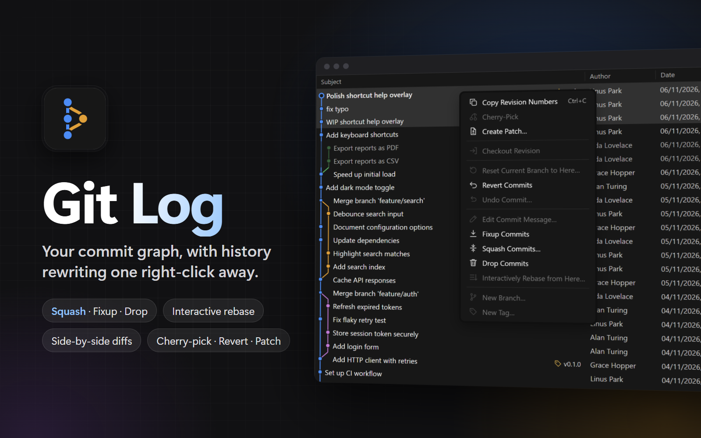
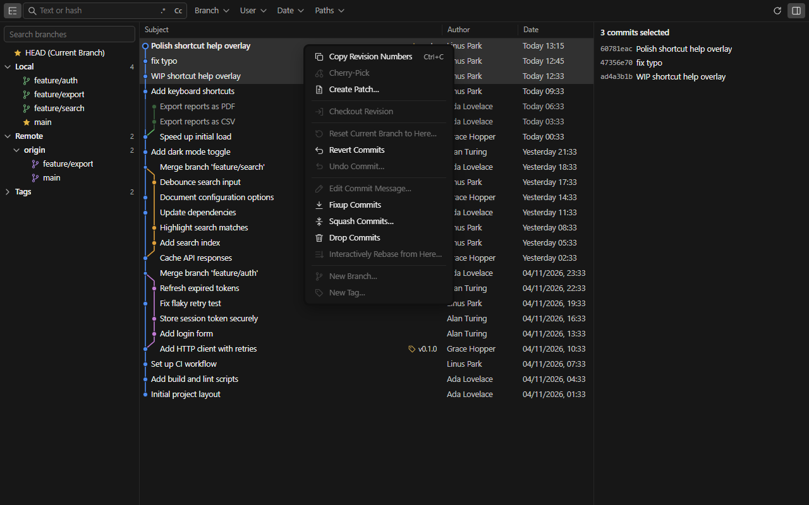
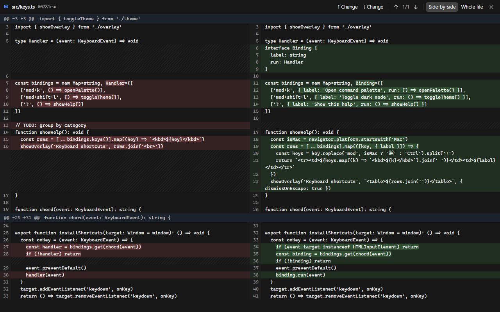
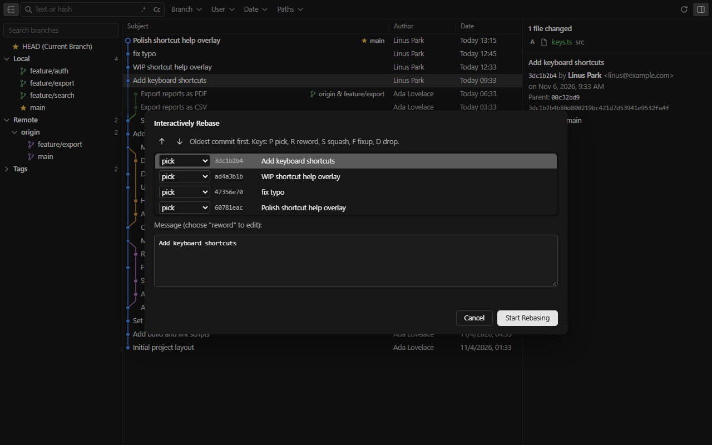
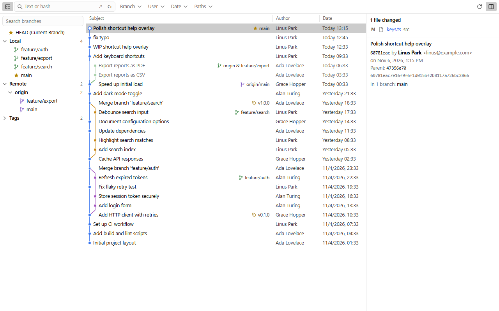

# Git Log for Orca



An [Orca](https://www.onorca.dev) plugin that adds a full **Git Log** view to Orca:
a colored commit graph with branch and tag labels, author/date/hash columns, filters, a branch tree,
a details pane with file diffs, and a right-click menu to rewrite history on a multi-selection.









## Features

- **Commit graph**: colored lanes with rounded curves at forks and merges, a fixed-width graph column,
  branch and tag labels framed in their lane color in front of the subject (a branch's remotes shown
  inside its label), every commit drawn as a solid dot. Uncommitted changes show as an
  "Uncommitted Changes (N)" row on top, joined to the HEAD commit by a dashed line. Select it to list
  the changed files of the work tree (staged, unstaged and untracked), click one to see its changes
  from HEAD, or use its **Open file** button to open it in the editor.
- **Filters**: text or hash (with regex `.*` and match case `Cc`), Branch, User, Date and Paths.
- **Branch tree**: Local, Remote and Tags; click a branch to show only its commits (click it again, or
  **Show all**, to see every branch; Ctrl+click to show several), double-click it or use its locate
  button to jump to its latest commit, right-click to check it out. The shown branches are highlighted.
  Branches named with slashes (`feature/auth`) are grouped in folders. Right-click a branch to check it
  out, merge it into the current branch, rebase the current branch onto it, rename or delete it.
- **Status, Fetch and Push**: the toolbar shows the current branch, how many commits it is behind (↙)
  and ahead (↗) of its upstream, and any rebase/merge in progress (click it to jump to HEAD). **Fetch**
  runs `git fetch --all --prune`; **Push** lists the commits to send, lets you pick the remote and the
  remote branch (publishing a new branch sets its upstream), and warns before a force push
  (`--force-with-lease`) when the remote has commits you do not have.
- **Remote projects**: a project on a paired Orca server or an SSH host opens too, read-only: Git Log
  runs git there through one terminal titled "Git Log (remote git)" and reads the answers back. Diff
  tabs and the Git Log tab open there as well. A paired server is reached with Orca's command line
  (`orca`), which Git Log looks for on PATH and inside the Orca app.
- **Safe checkout**: with uncommitted changes, choose to stash them first or carry them over.
- **Commit details**: selecting a commit opens it under its row in the log (Commit, Parents, Author,
  Committer, Date and the full message); click it again to fold it.
- **Details pane**: the changed files of the selected commit as a folder tree (single-child folders
  joined, file counts, fold/unfold, expand/collapse all), colored like Git: modified in yellow, added in green, deleted in red.
- **Diff viewer**: click a changed file (or press Enter on it) to open what the commit changed
  in its own editor tab, side by side (line numbers in the middle) or unified, with syntax colors for
  common languages and changed words highlighted. A slim toolbar moves
  between changes and files, counts the differences and switches the layout; a bar above each side shows
  its revision and path. The whole file is shown, scrolled to its first change; the expand button
  switches to only the changed regions and back (the choice is remembered). A ruler on the right marks
  every change (green added, red removed) where it sits in the file: click a mark to go to it, or click
  or drag anywhere on the ruler to scroll;
  jump between changes with F7 / Shift+F7 and between files with Alt+↑ / Alt+↓. Where a tab cannot open
  (no local workspace), it shows over the log instead and Esc closes it.
  Merge commits are compared with their first parent.
- **Multi-select**: click, Ctrl/⌘-click, Shift-click, arrows, Page Up/Down, Home/End, Ctrl+A. The details
  pane then lists every file the selected commits change, and its diff spans the whole selection.
- **Right-click menu** with icons (or Shift+F10):
  - Copy Revision Number (Ctrl+C), Cherry-Pick, Create Patch… (`git format-patch` of the selection,
    oldest first, saved to a file or copied to the clipboard)
  - Checkout Revision, checkout a branch at that commit, check out a remote branch as local
  - Reset Current Branch to Here… (soft / mixed / hard / keep), Revert Commits, Undo Commit
  - Edit Commit Message…, Fixup, Squash Commits…, Drop Commits, Interactively Rebase from Here…
  - New Branch…, New Tag…
- **Undo** banner after each rewrite (resets back to the previous HEAD with `--keep`).
- Commits already pushed to a remote branch trigger a warning before they are rewritten.
- Live refresh when the repository changes (commits, checkouts, fetches, rebases from a terminal).

## Where it shows

- **Right sidebar panel** "Git Log": a compact layout that drops columns as the panel narrows.
  Drag the borders between the column headers to resize Subject, Author, Date and Hash; double-click a
  border to reset them.
- **Git Log in a tab**: press **Git Log** in the status bar, run **Git Log: Open in a Tab** from the
  command palette, click the ↗ button in the panel, or pick **Git Log** in the tab bar + menu, for the
  full-width layout with the branch tree. The tab opens a small file named `Git Log.gitlog` at the
  workspace root (Orca names the tab after it); the plugin adds `*.gitlog` to `.git/info/exclude` so
  these files never show up as untracked. Diff tabs open similar files from a .orca-git-log/ folder
  (the newest 40 are kept), excluded the same way.

## Install

```sh
orca plugin install https://github.com/emamalet/Orca-git-log-panel
```

Requires Orca 1.4.248 or later and `git` on the `PATH` (or set **Git executable** in the plugin
settings). The plugin runs as a `trusted-worker`: it starts `git` with your user account.

### Develop

```sh
orca plugin dev load .          # prints a fingerprint; re-run with --approve <fingerprint>
orca plugin test .              # worker and graph tests on temporary repositories
orca plugin validate .
orca plugin shot local.git-log --panel log
node scripts/check-release.mjs  # version bump + changelog entry, required on main
```

Contributions are welcome: read [CONTRIBUTING.md](CONTRIBUTING.md) first (every change to `main`
ships as a new version with a changelog entry).

## How history rewriting works

Squash, fixup, drop, reword and the interactive rebase dialog all run `git rebase -i --autostash`
with a generated todo list (`GIT_SEQUENCE_EDITOR`) and messages written to a file, so no editor ever
opens. The selection must be a run of non-merge commits on the current branch. If the rebase stops on
a conflict it is aborted, and the branch is left exactly as it was.

## Limitations

- SSH and paired-host workspaces are read-only and slower than local ones: every git call goes through
  a terminal on that host, which needs `sh`, `git`, `gzip` and `base64` there. WSL folders opened from
  Windows (`\\wsl.localhost\...`) work through Git for Windows, which is slower there than inside WSL.
- The diff viewer is read-only, and very large diffs are cut after 20,000 lines.
- Conflicts during a rewrite, cherry-pick or revert are not resolved in the panel; the operation is
  aborted (or, when Git is left mid-operation by a terminal command, a banner says so).
- When several workspaces share the same name and branch, the panel matches the focused one through
  its terminal titles; if that is not enough it asks you to pick, and remembers the choice.

## License

MIT
